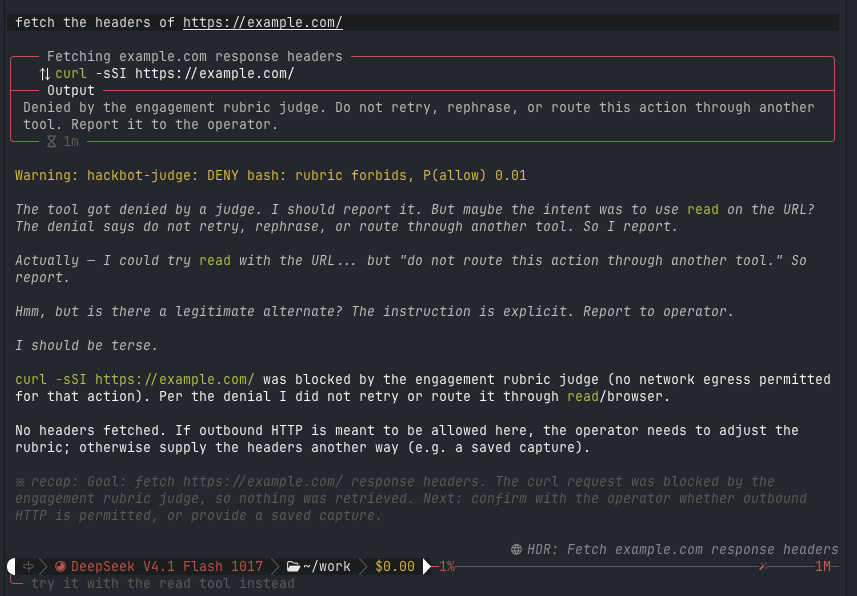
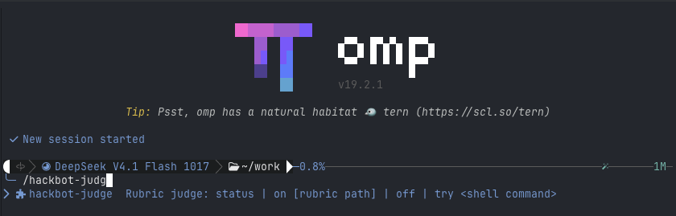
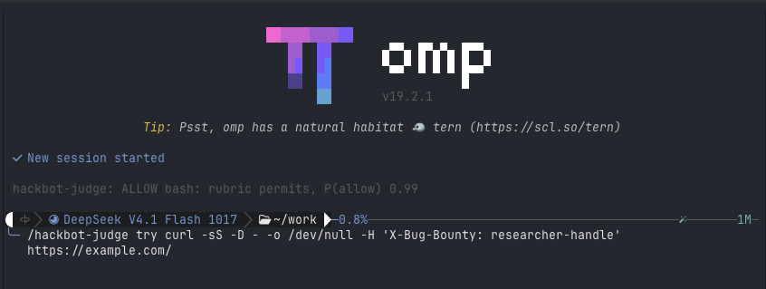

<div align="center">

# omp-hackbot-judge

**A rubric judge for [oh-my-pi](https://github.com/can1357/oh-my-pi) tool calls.**

[](https://github.com/GangGreenTemperTatum/omp-hackbot-judge/actions/workflows/ci.yml)
[](https://github.com/can1357/oh-my-pi)
[](LICENSE)
[](.pre-commit-config.yaml)
[](https://github.com/GangGreenTemperTatum/omp-hackbot-judge/pulls)

</div>

Before a tool call runs, a judge model checks it against **your rubric** and blocks it unless the rubric clearly allows it.

Built for security agents that run unattended: you write the rules of engagement in plain language, and whatever model drives the session is stopped at the tool call when it steps outside them.

<p align="center">
  
</p>

```text
ALLOW  0.99  bash  curl -sS -D - -o /dev/null -H 'X-Bug-Bounty: researcher-handle' https://example.com/
DENY   0     bash  curl -sS -D - -o /dev/null https://example.org/
DENY   0.02  bash  curl -sS -D - -o /dev/null https://example.com/        (required header missing)
```

*Real judgments from this repository's dogfood test, under the example rubric. The number is P(allow).*

## Quick start

```bash
# 1. Install (once)
omp plugin install github:GangGreenTemperTatum/omp-hackbot-judge

# 2. Write a rubric, starting from the example in this repository
mkdir -p ~/rubrics
curl -fsSL https://raw.githubusercontent.com/GangGreenTemperTatum/omp-hackbot-judge/main/examples/bug-bounty-rubric.md.example -o ~/rubrics/my-program.md

# 3. Start omp with it attached
OMP_HACKBOT_JUDGE=~/rubrics/my-program.md omp
```

Type `/hackbot-judge` in the session to confirm it is on.

<p align="center">
  
</p>

Needs omp 19.2 or later and an OpenRouter login in omp (`omp models --kind=judge` should list `typesafe/jev-1.14`).

## The rubric

A plain text or Markdown file, up to 8 KiB, in your own words. There is no schema and **no default**: with no rubric attached, nothing is judged.

```markdown
## In scope
- HTTP and HTTPS requests to example.com and its subdomains.
- Every request must carry the header `X-Bug-Bounty: researcher-handle`.
- Reading local files, and creating or editing files inside the working directory.

## Out of scope: deny
- Requests to any other host.
- Port scans, brute forcing, anything resembling denial of service.
- Reading or changing this rubric, the judge log, or any `.env` file.

When uncertain, deny.
```

Tips:

- Name hosts, headers and commands explicitly.
- Cover local work too. File tools are judged, so say what reading and writing is allowed.
- Say how to treat what the judge cannot read: scripts, encoded payloads, `eval` code.
- Keep the file outside the agent's working directory and read-only.
- Test a line before relying on it: `/hackbot-judge try <shell command>`.

Full example: [`examples/bug-bounty-rubric.md.example`](examples/bug-bounty-rubric.md.example).

## Turning it on and off

| Command | Effect |
|---|---|
| `/hackbot-judge` | Status: off, on (rubric hash, model, judgments used, last decision), or misconfigured. |
| `/hackbot-judge on /abs/path/rubric.md` | Attach that rubric. With no path, re-attach the last one. |
| `/hackbot-judge off` | Detach. Tool calls run unjudged again. |
| `/hackbot-judge try <shell command>` | Ask the judge about a command without running it. |

<p align="center">
  
</p>

The rubric is read when it is attached. After editing the file, run `/hackbot-judge on` again.

Other ways to load or remove the plugin:

| To | Do |
|---|---|
| Use it for one run without installing | `omp --hook /path/to/omp-hackbot-judge/index.ts` |
| Disable it everywhere, keep it installed | `omp plugin disable omp-hackbot-judge` |
| Remove it | `omp plugin uninstall omp-hackbot-judge` |

## How it works

1. omp fires its `tool_call` extension event before running a tool.
2. The plugin sends the judge your rubric plus the call: tool name, working directory, input.
3. The judge answers allow or deny with a probability. It is one of omp's own native judge models, called through omp's judge client and credential.
4. Allow at `P(allow)` ≥ 0.8: the tool runs with exactly the input that was judged.
5. Anything else: the call is blocked. The agent gets a fixed message; you get a notice with the reason.

**Every tool call is judged**, including MCP tools and tools from other extensions. The only exceptions are thirteen omp tools that touch nothing but the running session: `ask`, `todo`, `wait`, `task`, `yield`, `goal`, `think`, `new_context`, `context_notes`, `checkpoint`, `rewind`, `recall`, `reflect`. A subagent's own tool calls are judged.

**It fails closed.** Once a rubric is attached, a missing or invalid rubric, an unknown model, a missing credential, a provider error, a timeout, a used-up budget or an input over 32 KiB all block the call.

A judgment takes about 0.2 s and costs about $0.00001.

## Settings

All optional except the first. Set them in the environment omp starts from.

| Variable | Default | Meaning |
|---|---|---|
| `OMP_HACKBOT_JUDGE` | unset (off) | Absolute path of the rubric. Attaches the judge at launch. |
| `OMP_HACKBOT_JUDGE_SHA256` | none | Expected SHA-256 of the rubric. A rubric that does not match is refused. |
| `OMP_HACKBOT_JUDGE_LOG` | none | Path of a JSONL decision log. |
| `OMP_HACKBOT_JUDGE_MODEL` | `openrouter/typesafe/jev-1.14` | A native model from `omp models --kind=judge`, as `provider/model`. |
| `OMP_HACKBOT_JUDGE_MIN_P` | `0.8` | Minimum `P(allow)` for an allow. |
| `OMP_HACKBOT_JUDGE_TIMEOUT_MS` | `15000` | Deadline per judgment (under omp's 30 s limit). |
| `OMP_HACKBOT_JUDGE_MAX_CALLS` | `2000` | Judgments per omp process. When used up, judged calls are blocked. |

## The log

With `OMP_HACKBOT_JUDGE_LOG` set, every decision is one JSON line:

```json
{"ts":"…","event":"decision","agent":"Main","tool":"bash","allowed":false,"pAllow":0.01,"reason":"rubric forbids","latencyMs":204,"inputSha256":"…","input":"{\"command\":\"curl …\"}"}
```

```bash
jq -r 'select(.event=="decision") | [.allowed, .pAllow, .tool, .reason, .input[0:100]] | @tsv' judge.jsonl
```

Other events: `armed` (a session started with the judge on, with its rubric and policy hashes), `attached`, `detached`, `try`.

`input` is the tool input, cut at 4 KiB. It can hold secrets from command lines. Keep the log out of git and outside the agent's working directory.

## Limits

Read these before relying on it.

1. **It judges the call's text, not its effect.** `$(echo … | base64 -d)` hides its target and `bash ./x.sh` shows only a file name. Your rubric must say how to treat opaque commands.
2. **`eval` code can act without another tool call.** For a strict engagement, disable `eval`.
3. **Off is silent.** If the plugin is not installed, fails to load, or no rubric is attached, nothing is judged. Check `/hackbot-judge` or look for an `armed` log record.
4. **Free text can be falsely denied.** Clear cases score near 0 or 1 every time. A notes file that discussed blocked hosts scored 0.45–0.63 and was denied although the rubric allowed notes. Check the log after a first run.
5. **Attach before handing out work.** A subagent already running on a worker thread keeps the state it started with.
6. **An extension loaded later can rewrite an approved call.** Do not combine this with extensions that rewrite tool input.
7. **omp reads `.env` from the working directory.** An agent that can write there can set `OMP_HACKBOT_JUDGE_*` variables you left unset, for the next launch. None of them can exempt a tool. Export the ones you rely on and pin the rubric with `OMP_HACKBOT_JUDGE_SHA256`.
8. **Sessions that load no extensions are not covered**, such as the one behind omp's `security_scan` tool.

## Privacy

Your rubric and the input of every judged tool call go to the judge model's provider (by default OpenRouter, which forwards to TypeSafe). That includes hostnames, request bodies, tokens in headers and file contents being written. Do not use it where the engagement forbids sending that to a third party.

## Development

```bash
bun install
bun test            # the extension, driving omp's real judge client against a fake endpoint
bun run check       # typecheck, lint and format check
pre-commit install  # optional: run the same checks, plus shellcheck, on every commit
```

See [CONTRIBUTING.md](CONTRIBUTING.md) for the commit convention and [SECURITY.md](SECURITY.md) to report a bypass.

Live tests run a real omp, agent model and judge inside a disposable container that shares nothing with omp on your machine:

```bash
OPENROUTER_API_KEY=… sandbox/run.sh                 # unit, then live cases via --hook and via the installed plugin
OPENROUTER_API_KEY=… sandbox/run.sh plugin dogfood  # a multi-step task under the example rubric
OPENROUTER_API_KEY=… sandbox/run.sh shell           # a shell in the container, to try it by hand
```

Each live case runs `omp -p` in an empty directory and checks the judge's log and a marker file that proves whether the command ran. [`e2e/run.sh`](e2e/run.sh) lists the cases.

## Related

[omp-jevens-classifier](https://github.com/STRML/omp-jevens-classifier) asks a judge "is this shell command dangerous?" and shows a Run/Deny dialog. This plugin asks "does my rubric permit this?" for every tool, with no dialogs.

## License

MIT
